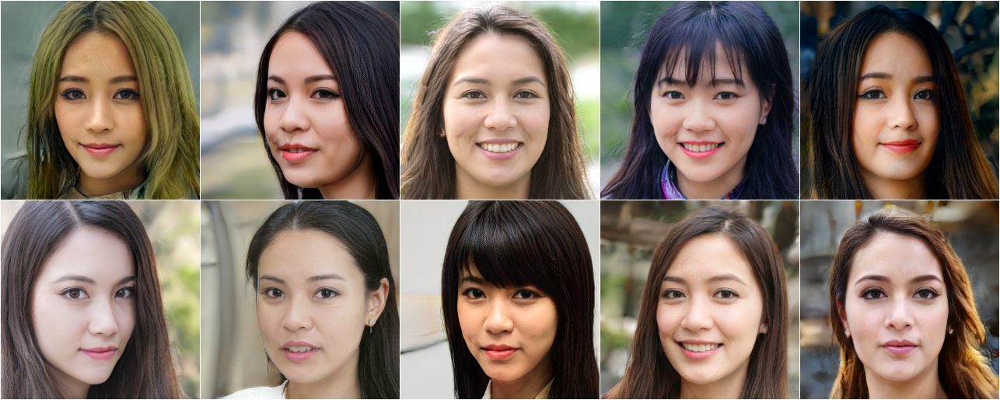
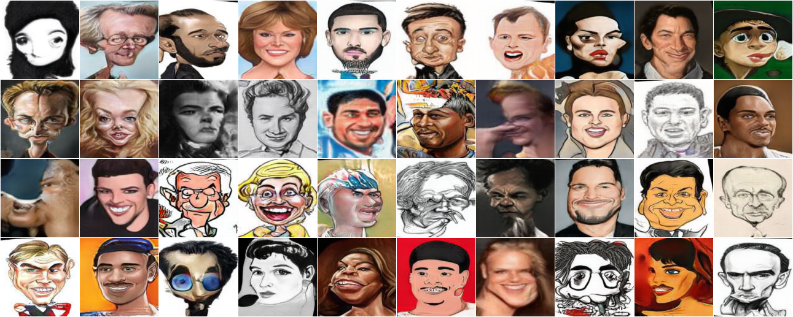

# StyleGAN.pytorch

> A historical, unofficial PyTorch implementation of the original StyleGAN.

This repository implements the StyleGAN architecture described in [A Style-Based
Generator Architecture for Generative Adversarial Networks](http://stylegan.xyz/paper).
It was created before NVIDIA published its later official PyTorch implementations
and is kept useful for historical reproducibility, code reading, and experiments
that depend on this codebase.

For new projects, start with NVIDIA's [official StyleGAN2-ADA PyTorch
implementation](https://github.com/NVlabs/stylegan2-ada-pytorch) instead.

<p align="center">
     <br>
     <a href="http://www.seeprettyface.com/mydataset.html">ChineseGirl Dataset</a>
</p>

## Project status

This is legacy research software under conservative maintenance. The repository
does not currently claim a supported Python/PyTorch/CUDA compatibility matrix,
CPU-only support, numerical equivalence with NVIDIA checkpoints, or reproducible
training on modern environments. Those claims require verification before they
are added to the documentation.

The configuration files contain machine-specific dataset and output paths. Edit
those paths before starting a training run. Pretrained weights and datasets are
not included in this repository.

## Implemented features

- Progressive growing and fade-in training
- Exponential moving average of generator weights
- Equalized learning rate
- PixelNorm and minibatch standard deviation layers
- Style mixing regularization
- Truncation trick
- Conditional GAN mode
- Gradient clipping and several legacy GAN loss options
- TensorFlow-to-PyTorch checkpoint conversion through `convert.py` (legacy path;
  conversion compatibility is not currently verified)

The following are not implemented or are not currently validated:

- Multi-GPU/distributed training
- FP16 or mixed-precision support
- A modern packaging or installation workflow
- A maintained pretrained-weight release

## Installation

The intended legacy dependency setup is:

```shell
python -m pip install -r requirements.txt
```

`requirements.txt` intentionally reflects the historical project and does not
pin versions. The repository's modern compatibility baseline is still being
established, so the command above should not be interpreted as a guarantee that
the project works with every current Python or PyTorch release.

The optional `convert.py` workflow additionally requires a TensorFlow environment
compatible with the original NVIDIA checkpoint tooling. It is separate from the
default training and generation dependencies.

## Training

1. Choose a configuration under [`configs/`](configs/).
2. Update `output_dir`, `dataset.img_dir`, `dataset.resolution`, and the device
   settings for your machine.
3. Start training:

```shell
python train.py --config configs/sample.yaml
```

The sample configurations target the historical progressive-training workflow
and generally assume CUDA. Training is expected to require a dataset arranged as
either a flat directory or a directory of subdirectories, according to the
configuration's `dataset.folder` value.

### Conditional training

Set `conditional: True` and use a directory accepted by
`torchvision.datasets.ImageFolder`. Each immediate subdirectory is one class;
the class names are sorted alphabetically and converted to integer labels:

```text
data/conditional/
├── class_a/
│   ├── image-001.jpg
│   └── image-002.jpg
└── class_b/
    ├── image-001.jpg
    └── image-002.jpg
```

Copy [`configs/sample_conditional.yaml`](configs/sample_conditional.yaml),
then set `dataset.img_dir`, `output_dir`, and `n_classes`. `n_classes` must
equal the number of class subdirectories. In conditional mode, `dataset.folder`
is ignored because `ImageFolder` is always used. Start the run with:

```shell
python train.py --config configs/sample_conditional.yaml
```

The conditional configuration uses `loss: 'conditional-loss'`; labels are
loaded from `ImageFolder` and passed to both the generator and discriminator.
The training entry point checks the class count before starting, so a mislabeled
directory produces an actionable configuration error.

To resume from checkpoints produced by this repository, provide actual checkpoint
paths (the examples below use placeholders):

```shell
python train.py \
  --config configs/sample.yaml \
  --start_depth 5 \
  --generator_file path/to/generator.pth \
  --gen_shadow_file path/to/generator_shadow.pth \
  --discriminator_file path/to/discriminator.pth \
  --gen_optim_file path/to/generator_optimizer.pth \
  --dis_optim_file path/to/discriminator_optimizer.pth
```

## Generation

All generation scripts expect a generator checkpoint produced by this repository
or by the conversion workflow below. Use a configuration matching the checkpoint's
resolution and model settings.

Generate individual samples:

```shell
python generate_samples.py \
  --config configs/sample_ffhq_128.yaml \
  --generator_file path/to/generator.pth \
  --num_samples 20 \
  --output_dir output/samples
```

Generate a grid:

```shell
python generate_grid.py \
  --config configs/sample_ffhq_128.yaml \
  --generator_file path/to/generator.pth \
  --output_dir output/grid
```

### Reuse a latent code

The normal generation path samples a latent vector `Z` in memory and passes it
through the mapping network to produce a per-layer `W` (also called `dlatent`)
code. `Z` is not saved automatically. To reuse a particular output, save its
`W` code as a NumPy `.npy` file with shape
`[num_layers, dlatent_size]` (for example, `[12, 512]` for a 128x128 model):

```python
# after creating/loading `gen` with the matching config and checkpoint
import numpy as np
import torch

with torch.no_grad():
    z = torch.randn(1, opt.model.gen.latent_size)
    w = gen.g_mapping(z)                         # [1, num_layers, dlatent_size]
    np.save("w.npy", w[0].cpu().numpy().astype(np.float32))
```

Then pass that `W`/`dlatent` code to the single-sample interface:

```shell
python generate_samples.py \
  --config configs/sample_ffhq_128.yaml \
  --generator_file path/to/generator.pth \
  --input w.npy \
  --output output/from_w.png
```

The `--input` path expects a post-mapping `W`/`dlatent` code, not a `Z` vector.
The script validates the shape and converts the array to `float32` before
running synthesis.

### Deterministic interpolation

Noise is sampled independently at every synthesis layer by default. For an
interpolation animation, fix the synthesis noise once so that only the latent
code changes between frames:

```python
gen.eval()
gen.set_noise_seed(123)

w_a = gen.g_mapping(z_a)
w_b = gen.g_mapping(z_b)
for step in range(30):
    t = step / 29.0
    w = torch.lerp(w_a, w_b, t)
    image = gen.g_synthesis(w, depth=out_depth, alpha=1.0)
```

The repository also provides a complete PNG-frame and GIF generator. It uses
linear interpolation in W space and fixed per-layer noise by default:

```shell
python generate_interpolation.py \
  --config configs/sample_ffhq_128.yaml \
  --generator_file path/to/generator.pth \
  --seed_a 0 --seed_b 1 --steps 30 \
  --output_dir output/interpolation
```

Pass `--random_noise` only when changing noise between frames is intentional.

Style mixing and truncation figures are generated with:

```shell
python generate_mixing_figure.py \
  --config configs/sample_race_256.yaml \
  --generator_file path/to/generator.pth

python generate_truncation_figure.py \
  --config configs/sample_cari2_128_truncation.yaml \
  --generator_file path/to/generator.pth
```

## Converting an official TensorFlow checkpoint

`convert.py` contains the historical TensorFlow-to-PyTorch parameter translation:

```shell
python convert.py \
  --config configs/sample_ffhq_1024.yaml \
  --input_file path/to/karras2019stylegan-ffhq-1024x1024.pkl \
  --output_file ffhq_1024_gen.pth
```

This path uses legacy TensorFlow utilities and Python pickle checkpoints. Only
use checkpoint files from a trusted source, and treat conversion results as
requiring validation until compatibility tests are available.

## Example outputs

The images below are historical examples checked into the repository; they are
not a guarantee that the same outputs can be reproduced in a current environment.

<p align="center">
     <br>
     <a href="https://github.com/NVlabs/ffhq-dataset">FFHQ Dataset (128x128)</a>
</p>

<p align="center">
     <br>
     <a href="https://github.com/NVlabs/ffhq-dataset">FFHQ Dataset (1024x1024)</a>
</p>

<p align="center">
     <br>
     <a href="https://cs.nju.edu.cn/rl/WebCaricature.htm">WebCaricature Dataset (128x128)</a>
</p>

## Repository references

- [NVIDIA StyleGAN](https://github.com/NVlabs/stylegan)
- [akanimax/pro_gan_pytorch](https://github.com/akanimax/pro_gan_pytorch)
- [lernapparat/lernapparat](https://github.com/lernapparat/lernapparat)

## Maintenance queue

The current open Issue inventory and verification plan are tracked in
[`docs/issue-triage.md`](docs/issue-triage.md). Reports are classified by
priority, but remain unverified until a reproduction or supporting evidence is
recorded.

The current weight-conversion findings are recorded in
[docs/weight-conversion-research.md](docs/weight-conversion-research.md), and
the staged maintenance and research roadmap is in
[docs/iteration-roadmap.md](docs/iteration-roadmap.md).

## License and provenance

The repository includes [`LICENSE.txt`](LICENSE.txt) and
[`LICENSE_ORIGINAL.txt`](LICENSE_ORIGINAL.txt). The source contains code and
adaptations attributed in the repository to NVIDIA StyleGAN and other upstream
projects. A file-by-file provenance and licensing review is still pending; do
not infer from this README that the whole repository is OSI-licensed or that all
files have the same copyright holder. Preserve the relevant upstream notices when
redistributing or modifying the code.

See [`NOTICE.md`](NOTICE.md) for a concise third-party notice and
[`docs/license-provenance.md`](docs/license-provenance.md) for the current
component-level audit and open questions.

## Contributing

Small, reviewable maintenance fixes are welcome. Please include reproduction
steps and validation results for compatibility or correctness changes. Issues and
pull requests should distinguish verified behavior from historical assumptions.
